# 🛡️ RAKSHASETU (रक्षासेतु)
### AI-Powered Disaster Preparedness & Emergency Response Platform

<p align="center">
  <strong>INNOVIK 6.0 | Team UnoReverse</strong>
  <br/>
  Intelligent Monitoring • Predictive Analytics • Emergency Coordination • Citizen Safety
</p>

<p align="center">
  
  
  
  
</p>

---

## 🌍 1. Project Overview

**RakshaSetu (रक्षासेतु)** is an AI-powered disaster preparedness and emergency response platform designed to connect environmental monitoring, intelligent threat detection, citizen emergency reporting, government coordination, and field responder operations within a unified ecosystem.

The platform aims to transform traditional reactive disaster management into a more intelligent, coordinated, and data-driven approach.

RakshaSetu combines machine learning, environmental sensor analysis, anomaly detection, forecasting, emergency prioritization, and centralized operational dashboards.

### Our Vision

To build an intelligent digital bridge between citizens, emergency responders, government authorities, and environmental intelligence systems.

### Core Philosophy

**SENSE → ANALYZE → PREDICT → PRIORITIZE → RESPOND → RECOVER**

---

## 🎯 2. Problem Statement

Disaster management involves multiple stakeholders, environmental data sources, emergency reporting systems, and response teams.

However, fragmented information, delayed threat identification, limited forecasting capabilities, and inefficient coordination can affect emergency preparedness and response.

RakshaSetu addresses these challenges through:

- Intelligent environmental monitoring.
- AI-powered anomaly detection.
- Predictive environmental analytics.
- Centralized emergency reporting.
- Citizen SOS assistance.
- Priority-based incident management.
- Government command and control.
- Field responder coordination.

---

## 🚀 3. Key Features

| Feature | Description |
|---|---|
| AI-Based Monitoring | Intelligent environmental data analysis |
| Anomaly Detection | Statistical and deep-learning-based anomaly identification |
| Aurora Forecasting | Time-series environmental condition forecasting |
| Sensor Fusion | Multi-source environmental information integration |
| Citizen SOS | Emergency reporting and location assistance |
| Government Command Center | Centralized incident monitoring |
| Responder Dashboard | Mission and incident management |
| Priority Engine | P1, P2, P3 and P4 classification |
| Multilingual Assistance | Disaster guidance and citizen support |
| Administration | Access management and audit monitoring |

---

## 🏗️ 4. Complete System Architecture

The RakshaSetu ecosystem is organized into six logical layers.

1. External Data Sources
2. Presentation Layer
3. Application and Backend Layer
4. AI/ML Intelligence Layer
5. Event Communication Layer
6. Data and Governance Layer

### Master Architecture Diagram

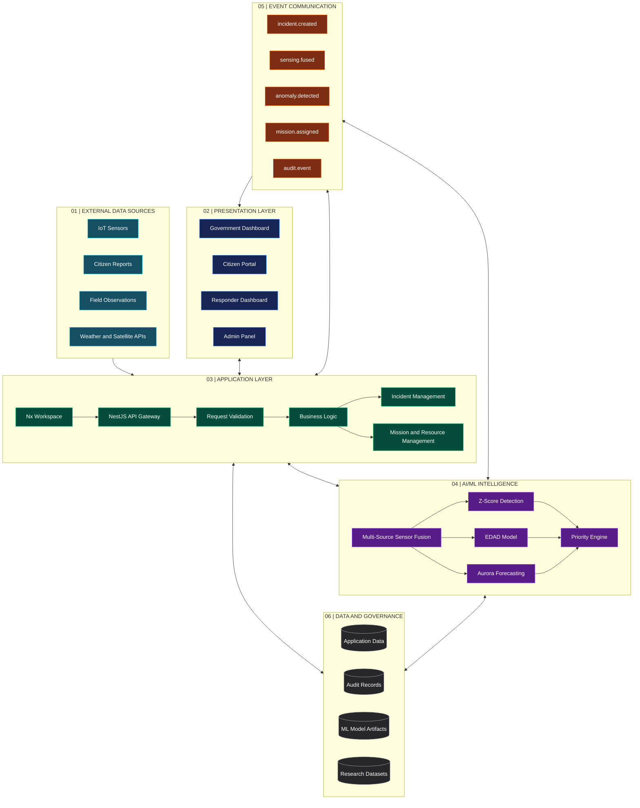

*Architecture note: This diagram represents the logical platform design. Individual connections should be considered implemented only where corresponding application code and integrations exist.*

---

## 🔄 5. Complete Disaster Management Workflow

The following workflow represents the complete intended disaster management lifecycle.

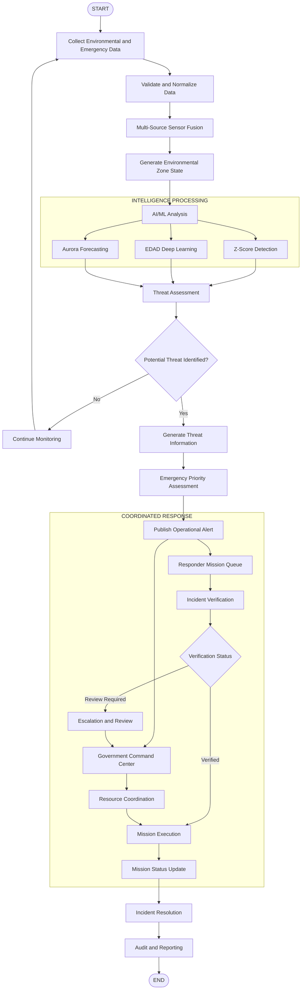

### Workflow Explanation

1. Environmental and emergency data is collected.
2. Input data is validated and normalized.
3. Multiple sources are combined through sensor fusion.
4. AI/ML components analyze environmental patterns.
5. Potential anomalies and forecast information are assessed.
6. Incidents are assigned operational priorities.
7. Government authorities receive relevant information.
8. Responders review and execute assigned missions.
9. Mission status is updated.
10. Incident information is retained for reporting and audit.

---

## 🖥️ 6. Four Operational Panels

RakshaSetu is designed around four operational interfaces.

### 6.1 Government Command Center

**Purpose:** Centralized disaster monitoring and coordination.

Features:

- Live incident monitoring.
- Environmental threat visualization.
- Incident overview.
- Resource allocation monitoring.
- Department readiness.
- Inter-agency coordination.
- Emergency alerts.

### 6.2 Citizen Safety Portal

**Purpose:** Provide citizens with emergency reporting and safety assistance.

Features:

- One-tap SOS.
- Location-based emergency reporting.
- Photo evidence submission.
- Family safety check-in.
- Evacuation guidance.
- Multilingual disaster assistance chatbot.

### 6.3 Field Responder Dashboard

**Purpose:** Support emergency teams during field operations.

Features:

- P1–P4 incident priority queue.
- Incident verification.
- Mission assignment.
- Team status monitoring.
- Hazard-aware navigation.
- Field evidence submission.
- Mission escalation.
- Response updates.

### 6.4 Administration Panel

**Purpose:** Platform governance and administrative oversight.

Features:

- User management.
- Role-Based Access Control.
- Audit logs.
- System health monitoring.
- Backup and recovery workflows.
- Administrative configuration.

### Four-Panel Architecture

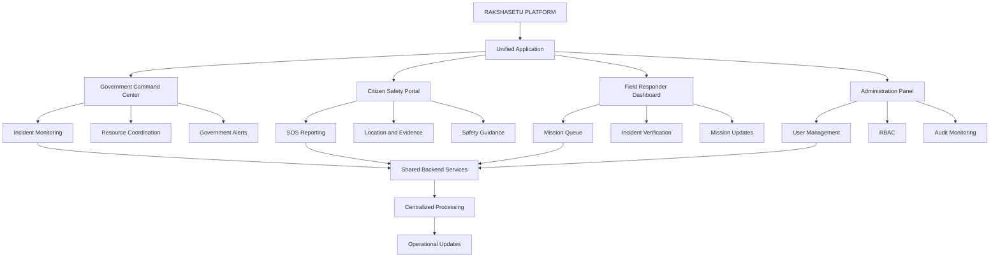

---

## ⚙️ 7. Technology Stack

The project documentation and supplied workspace information identify the following technologies and components.

| Layer | Technology |
|---|---|
| Frontend | Next.js |
| Backend | NestJS |
| Monorepo | Nx |
| Programming | TypeScript, JavaScript, Python |
| AI/ML | PyTorch |
| Data Processing | Pandas, NumPy |
| Statistical Analysis | Z-Score |
| Deep Learning | 1D-CNN, Bidirectional GRU |
| Forecasting | Seq2Seq, Temporal Attention |
| Event Architecture | Kafka topic design |
| Version Control | Git and GitHub |

*Technology availability and integration status must be checked against the corresponding project configuration.*

---

## 🧠 8. AI/ML Intelligence Architecture

The AI/ML subsystem provides the analytical capabilities for environmental monitoring, anomaly identification and forecasting.

### AI/ML Processing Flow

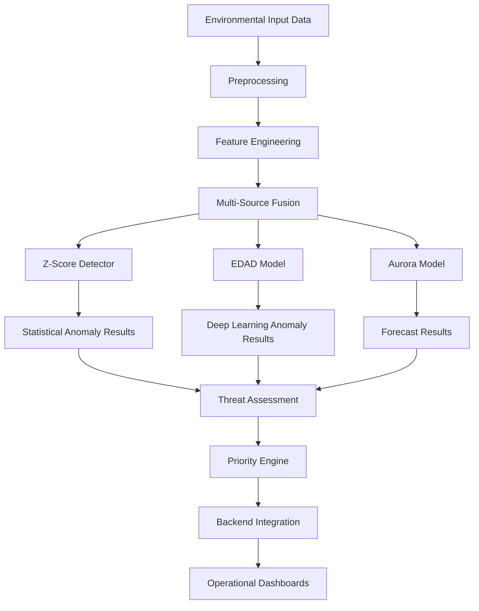

---

## 📊 9. Multi-Source Sensor Fusion

Sensor fusion combines environmental and operational inputs into a unified representation.

### Data Sources

1. IoT weather and hydrology sensors.
2. Citizen SOS and geo-reports.
3. Field responder observations.
4. Satellite and meteorological APIs.

### Sensor Fusion Architecture

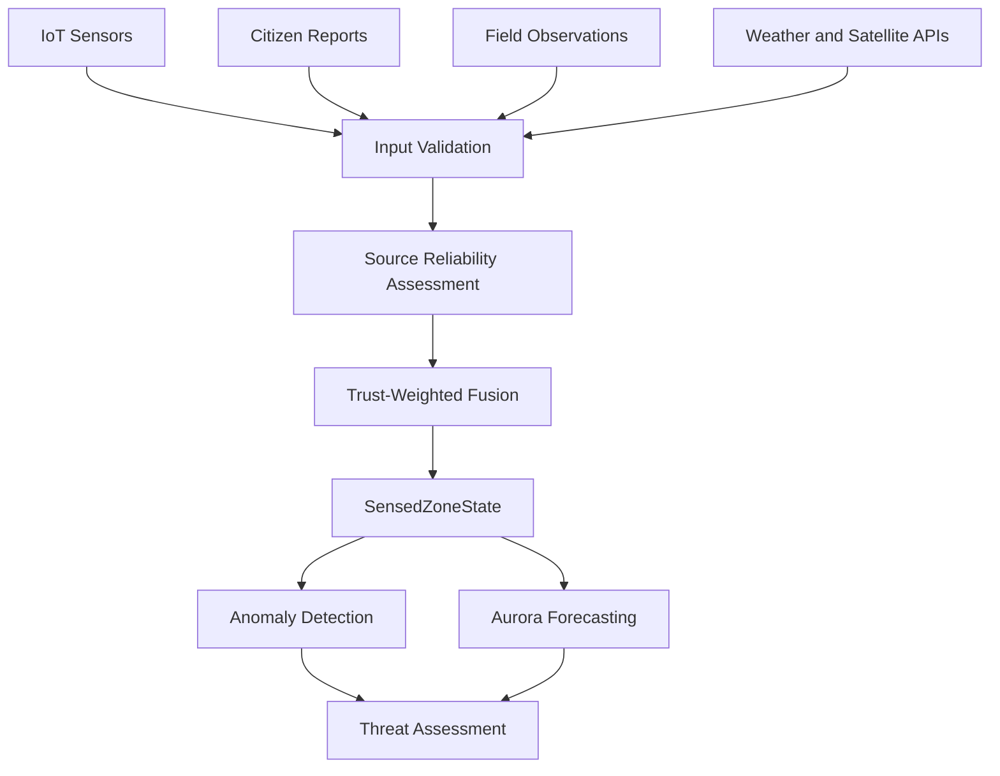

### Fusion Equation

The weighted fusion model can be represented as:

\[
FusedValue = \frac{\sum_{i=1}^{n}v_iw_i}{\sum_{i=1}^{n}w_i}
\]

Where:

- \(v_i\) = Value from source i.
- \(w_i\) = Trust weight of source i.
- \(n\) = Number of valid sources.

### Fusion Output

The conceptual `SensedZoneState` includes:

- Zone identifier.
- Environmental metric.
- Fused value.
- Confidence score.
- Source weights.

---

## 📈 10. Z-Score Anomaly Detection

The statistical anomaly detection component identifies observations that deviate from a calibrated baseline.

### Mathematical Representation

\[
Z = \frac{x-\mu}{\sigma}
\]

Where:

- \(x\) = Observed value.
- \(\mu\) = Baseline mean.
- \(\sigma\) = Baseline standard deviation.

### Documented Thresholds

- 2.0σ
- 2.5σ
- 3.0σ

### Detection Workflow

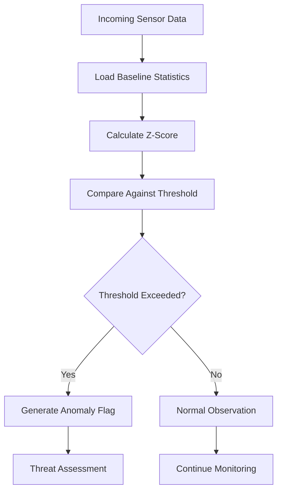

---

## 🔬 11. EDAD-Inspired Deep Learning Architecture

The EDAD-inspired model uses temporal representation learning for anomaly detection.

### Model Architecture

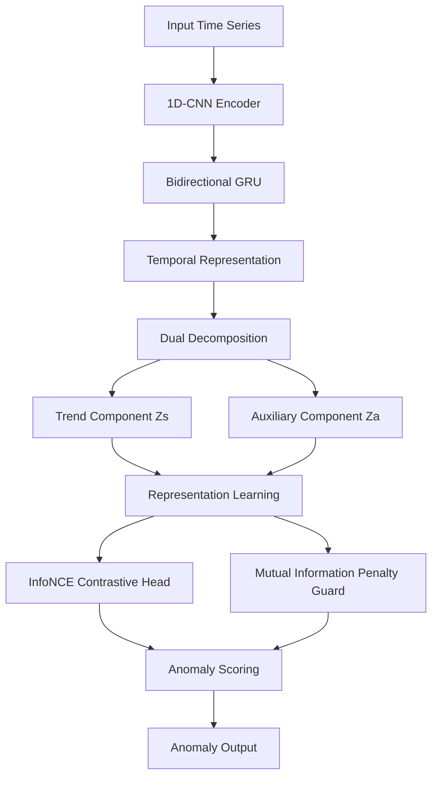

### Documented Model Details

| Parameter | Value |
|---|---|
| Model | EDAD-inspired |
| Encoder | 1D-CNN |
| Temporal Layer | Bidirectional GRU |
| Decomposition | Trend + Auxiliary |
| Contrastive Head | InfoNCE |
| Training Epochs | 15 |
| Trainable Parameters | 124,936 |

---

## 🔮 12. Aurora Forecasting Architecture

Aurora is the documented environmental condition forecasting model.

### Model Architecture

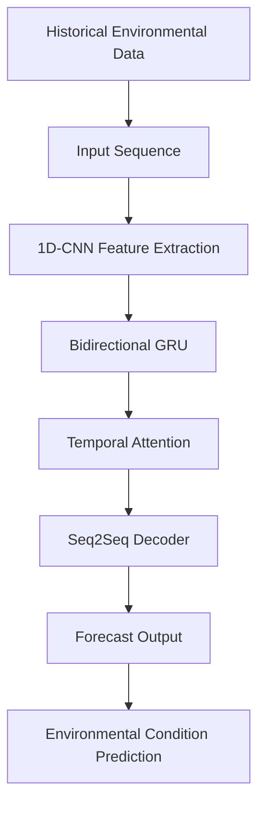

### Documented Characteristics

- 1D-CNN feature extraction.
- Bidirectional GRU.
- Temporal attention.
- Sequence-to-sequence architecture.
- One-hour-ahead forecasting.
- Eight environmental channels.

### Model Files

- `aurora_model.py`
- `aurora_best.pt`

---

## 🚨 13. Emergency Priority Queue Engine

The priority engine organizes incidents using multiple operational factors.

### Priority Assessment

- Incident severity.
- Affected population.
- Geographical proximity.
- Time sensitivity.
- Available resources.

### Priority Workflow

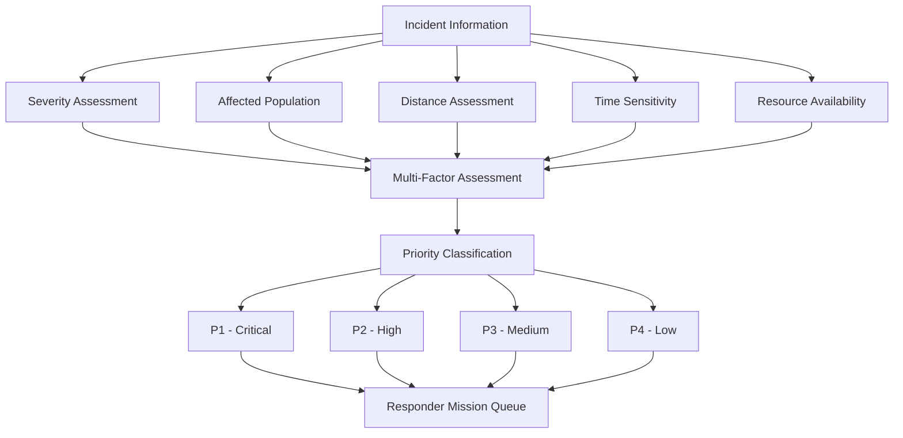

*Exact scoring weights and thresholds depend on the implemented priority engine.*

---

## 🆘 14. Citizen SOS Workflow

The Citizen Safety Portal provides an interface for emergency reporting.

### SOS Sequence Diagram

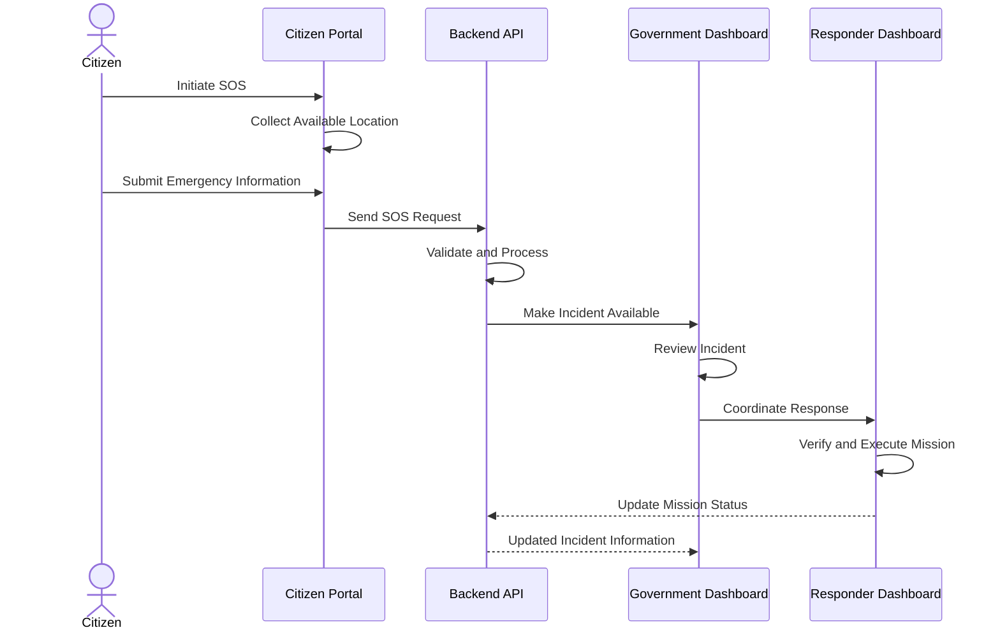

---

## 🏛️ 15. Government Command Center Workflow

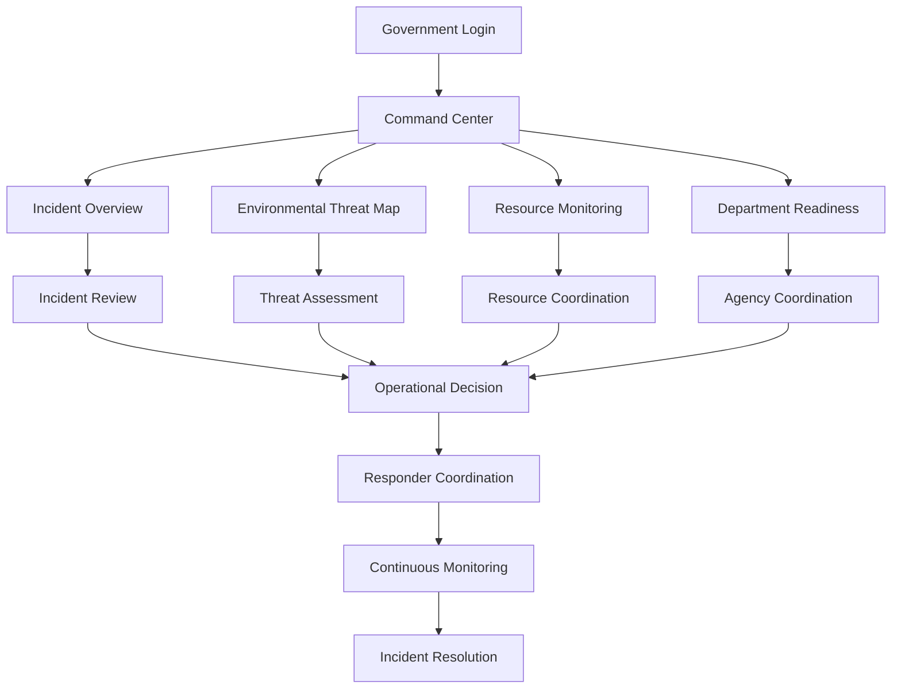

---

## 🚑 16. Field Responder Workflow

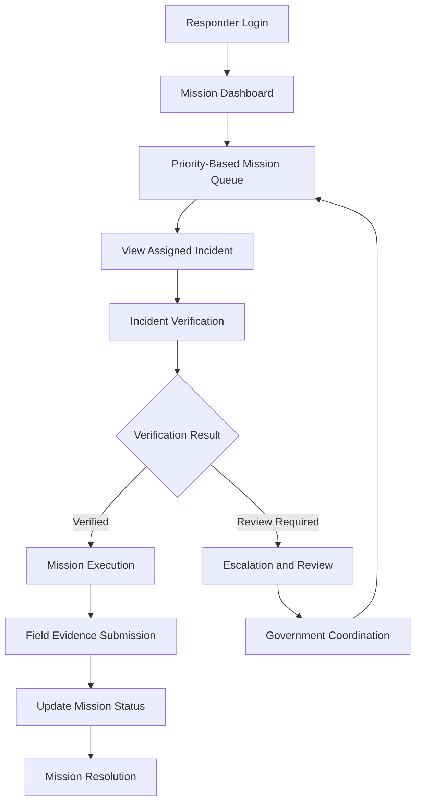

---

## 🔐 17. Administration and Access Control

The administration layer is responsible for platform governance.

### Conceptual RBAC Workflow

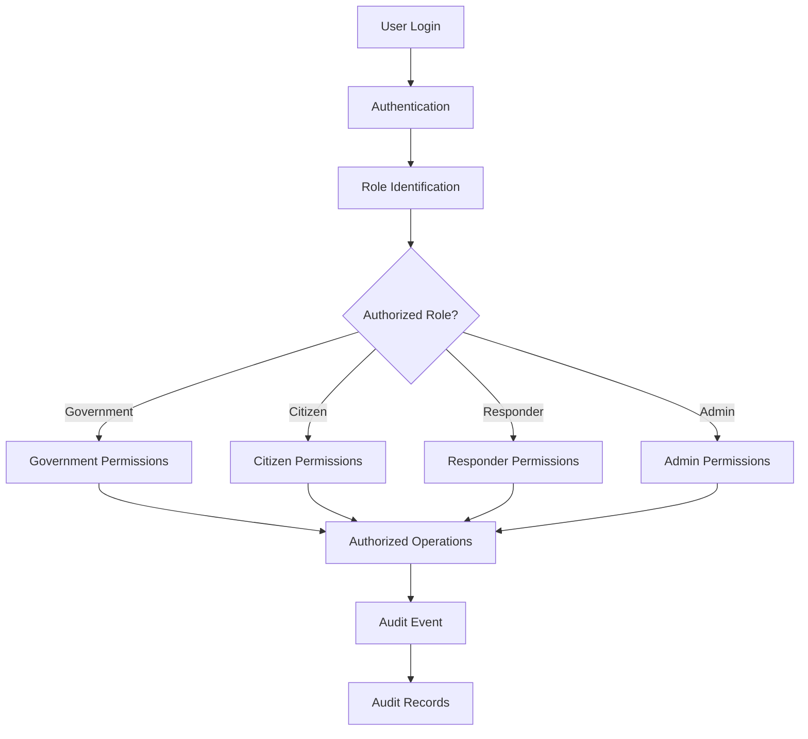

Security capabilities should be verified against the actual backend implementation.

---

## 📡 18. Event-Driven Communication Architecture

The project documents the following Kafka event topic design.

| Topic | Purpose |
|---|---|
| `incident.created` | New incident events |
| `sensing.fused` | Fused environmental information |
| `anomaly.detected` | Anomaly notifications |
| `mission.assigned` | Mission assignment events |
| `audit.event` | Administrative audit events |

### Event Communication Flow

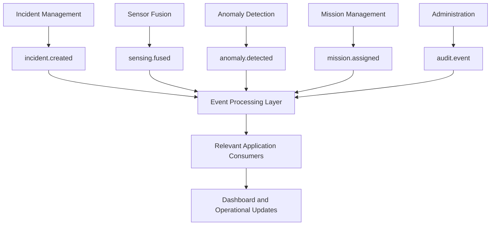

*Topic design does not by itself establish that a Kafka broker or all event consumers have been deployed.*

---

## 🧪 19. Research and Dataset Documentation

The research subsystem includes synthetic environmental data, preprocessing, training, inference and evaluation workflows.

### Dataset

`springbrook_wsn_synthetic_100k.csv`

| Property | Description |
|---|---|
| Total Samples | 100,000 |
| Sensor Nodes | 20 |
| Sampling Interval | 10 minutes |
| Environmental Features | 8 |
| Dataset Type | Synthetic anomaly benchmark |

### Environmental Features

1. `air_temperature_C`
2. `relative_humidity_pct`
3. `air_pressure_hPa`
4. `wind_speed_ms`
5. `wind_direction_deg`
6. `leaf_wetness_pct`
7. `soil_moisture_pct`
8. `solar_radiation_Wm2`

Battery voltage is reserved for device-health quality assurance.

### Research Pipeline

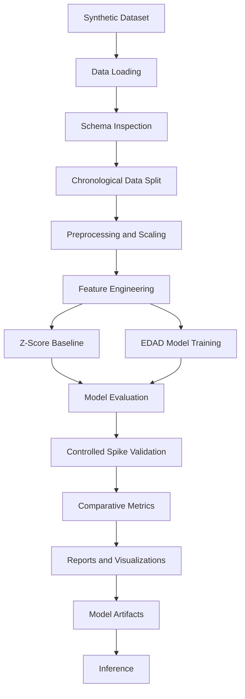

---

## 📊 20. Model Evaluation and Benchmark Results

Documented synthetic benchmark results:

**Test split: 14,790 windows**

| Metric | Z-Score | EDAD |
|---|---:|---:|
| Flag Rate | 41.09% | 2.04% |
| Mean Anomaly Burst Duration | 15.87 windows | 1.72 windows |
| Controlled Spike Detection | 100% | 83.42% |
| Inference Throughput | 1,152,183 windows/sec | 37,237 windows/sec |
| Trainable Parameters | 0 | 124,936 |

### Interpretation

- Z-Score provides a statistical baseline for comparison.
- EDAD provides a learned temporal representation for anomaly detection.
- Flag rate indicates the proportion of windows flagged by the respective method.
- Burst duration describes the average length of detected anomaly sequences.
- Controlled spike detection measures performance on the specified synthetic spike test.
- Throughput measures the documented inference benchmark.

**Research limitation:** These results come from a synthetic benchmark. They do not establish real-world disaster prediction accuracy or prove performance on live environmental sensor networks. Real-world validation is required.

---

## 📁 21. Repository Structure

The following is a high-level view of the documented repository components. Refer to the actual repository for the complete directory tree.

```text
RakshaSetu/
│
├── ml/
│   └── Machine Learning Components
│
├── rakshasetu-research/
│   └── Research and Model Development
│
├── .gitignore
├── README.md
│
├── aurora_best.pt
├── aurora_model.py
│
├── edad_best.pt
├── edad_model.py
├── edad_raw_scores.csv
├── edad_training_log.json
│
├── data_leakage_check.py
├── download_era5_7years.py
├── run_edad_inference.py
├── server.py
│
└── synthetic_test_cases_full.csv
```

The `ml/` and `rakshasetu-research/` directories contain additional components that should be explored for their individual scripts, datasets and configuration files.

---

## 🛠️ 22. Prerequisites

Before running the platform, ensure the required development tools are installed.

- Node.js
- npm
- Python 3
- Git
- VS Code or another development environment

Additional Python dependencies and frontend/backend requirements should be installed using the repository's actual dependency files.

---

## ⚙️ 23. Installation and Setup

### Step 1: Clone the Repository

```bash
git clone <YOUR_REPOSITORY_URL>
```

### Step 2: Navigate to the Project

```bash
cd <YOUR_PROJECT_DIRECTORY>
```

### Step 3: Install Node Dependencies

```bash
npm install
```

### Step 4: Configure Environment Variables

Create the required environment configuration based on the project's existing environment example files.

Do not commit API keys, passwords, private tokens or other secrets.

### Step 5: Set Up Python Environment

Navigate to the relevant ML or research directory and install its documented Python dependencies.

---

## 🖥️ 24. Running the Backend

The backend workspace uses Nx and NestJS.

From the Nx workspace root:

```bash
npx nx serve api-gateway
```

Build the backend:

```bash
npx nx build api-gateway
```

Inspect available targets:

```bash
npx nx show project api-gateway
```

Visualize workspace dependencies:

```bash
npx nx graph
```

---

## 🌐 25. Running the Frontend

From the Next.js application directory, use the available project scripts:

```bash
npm install
npm run dev
```

Open:

```text
http://localhost:3000
```

For a production build:

```bash
npm run build
```

---

## 🤖 26. Running AI/ML Components

The repository includes Python model scripts and trained model artifacts.

Examples of documented component files:

```text
aurora_model.py
edad_model.py
run_edad_inference.py
```

The actual execution commands depend on the scripts' arguments, Python dependencies and input file requirements.

For inference, use the relevant script's documented usage:

```bash
python run_edad_inference.py --help
```

If the script does not support `--help`, inspect its argument parser before executing it.

---

## 🔌 27. API Documentation

The NestJS API Gateway provides the backend entry point.

API documentation should be maintained using the actual implemented controllers and routes.

| Module | Responsibility |
|---|---|
| Authentication | User access and authentication |
| Incident Management | Incident lifecycle |
| Citizen SOS | Emergency reporting |
| Mission Management | Responder missions |
| Resource Management | Resource coordination |
| Administration | Platform governance |

Exact endpoint URLs, request bodies, response schemas and authentication requirements must be taken from the implemented backend controllers.

---

## ☁️ 28. Deployment Architecture

The following is the proposed logical deployment architecture.

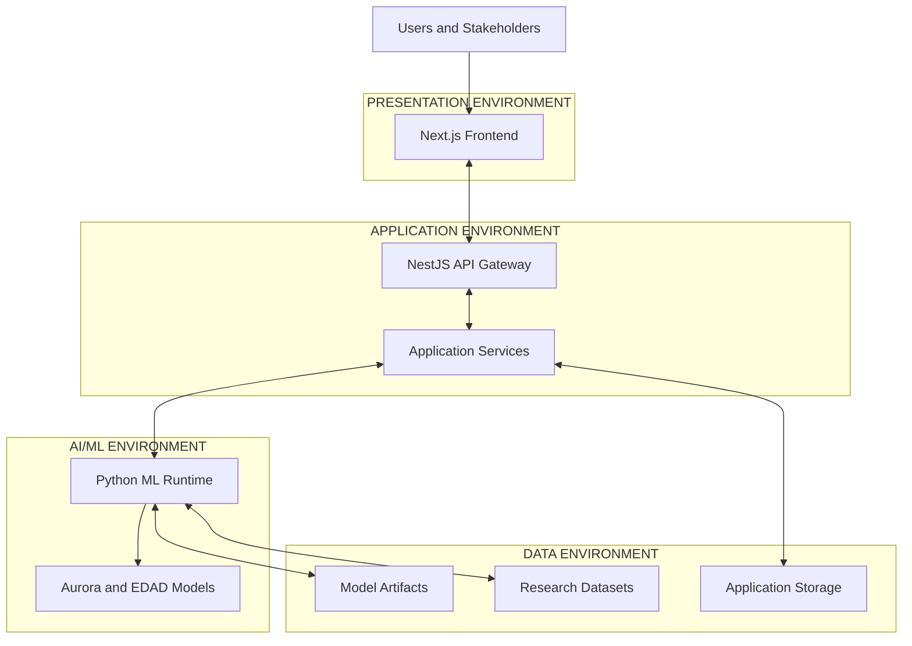

This represents a proposed logical deployment model. Actual hosting providers, cloud resources, database services and production infrastructure should be documented after deployment verification.

---

## 🧰 29. Testing and Validation

Testing should cover all major platform layers.

| Testing Area | Validation |
|---|---|
| Frontend | UI and navigation |
| Backend | API and business logic |
| AI/ML | Inference and model outputs |
| Dataset | Schema and data quality |
| Anomaly Detection | Baseline and controlled spike evaluation |
| Integration | Frontend-backend communication |
| Security | Authentication and authorization |
| Workflow | Incident and mission lifecycle |

---

## 🔒 30. Security and Reliability

Security and reliability are essential for disaster management systems.

Recommended engineering considerations:

- Role-based access control.
- Secure API communication.
- Input validation.
- Protection of citizen location information.
- Audit logging.
- Secure environment configuration.
- Backup and recovery.
- Error handling.
- Monitoring and observability.
- Human verification of critical emergency decisions.

AI-generated alerts should support authorized human decision-makers, not replace emergency authorities.

---

## 🔮 31. Future Scope

Potential future enhancements include:

1. Integration with live IoT sensor networks.
2. Real-time meteorological data integration.
3. Satellite imagery-based environmental analysis.
4. Improved geospatial disaster visualization.
5. Multilingual voice-based emergency assistance.
6. Advanced evacuation route planning.
7. Real-time resource optimization.
8. Mobile applications for citizens and responders.
9. Expanded real-world model validation.
10. Cloud-based scalable infrastructure.
11. Inter-agency data exchange.
12. Advanced disaster simulation and preparedness tools.

---

## 👥 32. Project Information

| Detail | Information |
|---|---|
| Project Name | RakshaSetu |
| Hindi Name | रक्षासेतु |
| Competition | INNOVIK 6.0 |
| Team | UnoReverse |
| Project Category | AI / ML and Disaster Management |
| Platform Type | Integrated Disaster Management Ecosystem |

---

## 🤝 33. Team UnoReverse

**Building technology for smarter disaster preparedness and safer communities.**

Team members:

- Yash Kumar Mishra
- Bhavyansh Parihar
- Aditi
- Priti

---

## 🌟 34. Our Mission

RakshaSetu aims to make disaster preparedness more intelligent, emergency coordination more structured, and critical information more accessible.

By connecting AI-driven environmental intelligence with citizen reporting, government coordination and field response, we envision a more connected disaster management ecosystem.

**Technology should not only identify problems. It should help people respond better.**

---

<p align="center">
  <strong>RAKSHASETU — Connecting Intelligence with Emergency Response.</strong>
  <br/>
  <em>Designed and developed by Team UnoReverse | INNOVIK 6.0</em>
</p>
